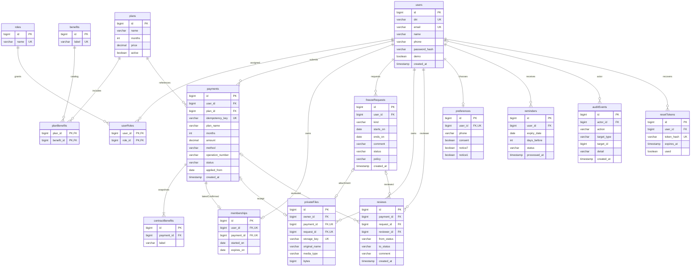

# Modelo entidad–relación

El SVG exportado está en [ER.svg](ER.svg). Los nombres camelCase del dibujo corresponden a tablas SQL snake_case; no son entidades adicionales.

En private_files y reviews exactamente una referencia (pago o solicitud) debe existir: la restricción CHECK impide ambos padres o ninguno. El ER expresa cardinalidades individuales; esa exclusión se comprueba en SQL. La clave alternativa (method, operation_number) aplica a pagos manuales con referencia no nula. recordatorios tienen UNIQUE(user_id, expiry_date, days_before). contract_benefits tiene UNIQUE(payment_id,label).
